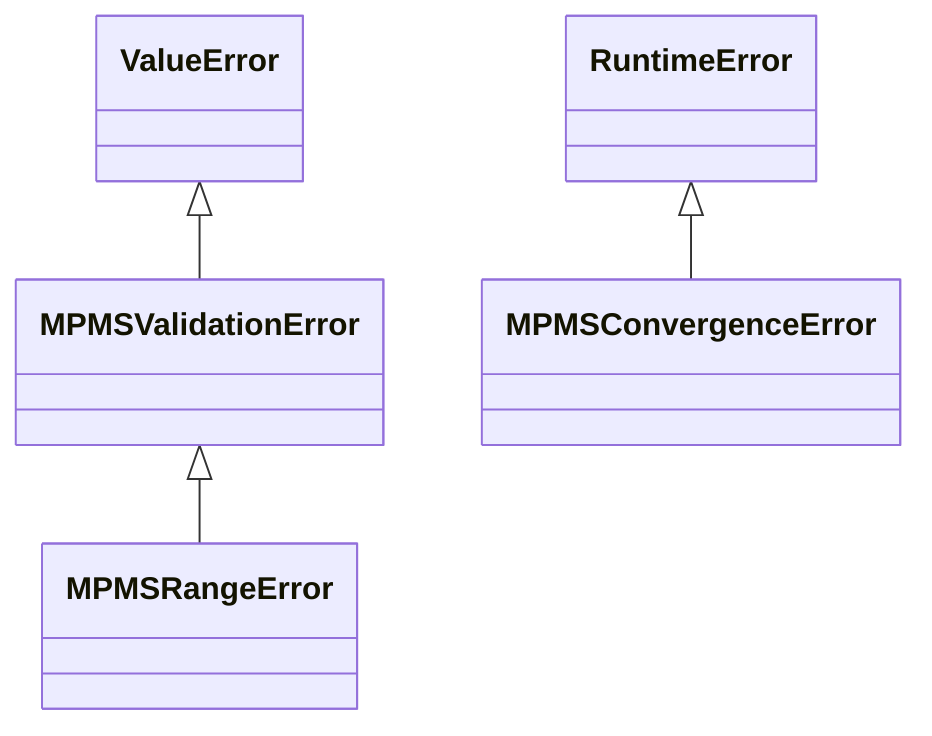

# 08 · Errores

[⬅ Anterior: Referencia · resultados](07_ref_resultados.md) · [Índice](README.md) · [Siguiente: Límites y unidades ➡](09_limites.md)

Cuando una entrada no permite aplicar la norma, la librería **lanza una excepción**: nunca devuelve ceros, `NaN` ni un valor extrapolado. Esta página explica cada excepción, cuándo ocurre y cómo manejarla.

## 📑 Contenido

1. [Jerarquía](#jerarquia)
2. [`MPMSRangeError` — fuera de límites](#range)
3. [`MPMSValidationError` — dato inválido](#validation)
4. [`MPMSConvergenceError` — sin convergencia](#convergence)
5. [`TypeError` — argumentos posicionales](#typeerror)
6. [Patrón de manejo recomendado](#patron)
7. [Catálogo de mensajes](#catalogo)

---

<a id="jerarquia"></a>
## 1. Jerarquía



| Excepción | Hereda de | Significado | ¿Qué hacer? |
|---|---|---|---|
| [`MPMSRangeError`](#range) | `MPMSValidationError` | El dato es válido pero está **fuera de los límites de la norma** | Informar al operador: la norma no aplica a ese producto o condición |
| [`MPMSValidationError`](#validation) | `ValueError` | El dato es **inválido** (tipo, `NaN`, combinación de parámetros) | Corregir el sistema que llama |
| [`MPMSConvergenceError`](#convergence) | `RuntimeError` | El cálculo iterativo no convergió | Caso excepcional; ver opciones abajo |

Todas se importan desde `api_mpms`. Los mensajes están en inglés y usan solo caracteres ASCII (`degF`, `kg/m3`, `1/degF`), así que se pueden escribir en cualquier consola o log.

```python
>>> from api_mpms import MPMSRangeError, MPMSValidationError, MPMSConvergenceError
>>> issubclass(MPMSRangeError, MPMSValidationError), issubclass(MPMSValidationError, ValueError)
(True, True)

```

---

<a id="range"></a>
## 2. `MPMSRangeError` — fuera de límites

Se lanza cuando una entrada, o la densidad base resultante, está fuera de los [límites de la norma](09_limites.md).

| Causa | Funciones |
|---|---|
| Temperatura fuera de −58 a 302 °F / −50 a 150 °C | Todas |
| Presión > 1500 psig (10 342.1 kPa / 103.421 bar) | Todas las de corrección |
| Densidad base fuera de límites del tipo | `correct_base_to_alternate`, tablas 6 y 24 |
| Densidad observada fuera de límites del tipo | `correct_observed_to_base`, funciones métricas, tablas 5, 23, 53 y 59 |
| La densidad base resultante quedaría fuera de límites | `correct_observed_to_base` y funciones métricas |
| α60 fuera de 230–930×10⁻⁶ °F⁻¹ (414–1674×10⁻⁶ °C⁻¹) | Tipo C y tablas C |

### Ejemplos

> `📘 Norma 11.1.6.1 · Ej. 9 · pág. PDF 52` `⚠️ Error` — temperatura por debajo de −58 °F

```python
>>> from api_mpms import correct_base_to_alternate, correct_observed_to_base
>>> correct_base_to_alternate(rho_60=610.629650107991, t_f=-58.05, p_psig=0, commodity_type="A")
Traceback (most recent call last):
    ...
api_mpms.exceptions.validation.MPMSRangeError: Temperature -58.05 degF out of range (-58 to 302 degF)

```

> `📘 Norma 11.1.6.1 · Ej. 11 · pág. PDF 52` `⚠️ Error` — presión mayor que 1500 psig

```python
>>> correct_base_to_alternate(rho_60=610.629650107991, t_f=92, p_psig=1501, commodity_type="A")
Traceback (most recent call last):
    ...
api_mpms.exceptions.validation.MPMSRangeError: Pressure 1501.0 psig out of range (0 to 1500 psig)

```

> `📘 Norma 11.1.6.2 · Ej. 15 · pág. PDF 71` `⚠️ Error` — densidad observada de lubricante por debajo de 714.3 kg/m³

```python
>>> correct_observed_to_base(rho_o=714.015375290433, t_o=72.32, p_o=0, commodity_type="D")
Traceback (most recent call last):
    ...
api_mpms.exceptions.validation.MPMSRangeError: rho_o 714.015375290433 kg/m3 out of range for commodity type D (714.3 to 1208.3 kg/m3)

```

> `📘 Norma 11.1.7.2 · Ej. 15 · pág. PDF 115` `⚠️ Error` — presión métrica por encima del límite (el mensaje usa la unidad de entrada)

```python
>>> from api_mpms import correct_metric_observed_to_base
>>> correct_metric_observed_to_base(
...     rho_o=1208.52, t_o_c=15.56, p_o=10342.5, pressure_unit="kPa", t_base_c=15, commodity_type="D",
... )
Traceback (most recent call last):
    ...
api_mpms.exceptions.validation.MPMSRangeError: Pressure 10342.5 kPa (1500.053 psig) out of range (0 to 10342.1 kPa = 1500 psig)

```

> `⚠️ Error` — α60 fuera de rango

```python
>>> correct_observed_to_base(rho_o=853.7, t_o=84.5, p_o=0, alpha_60=0.001)
Traceback (most recent call last):
    ...
api_mpms.exceptions.validation.MPMSRangeError: alpha_60 0.001 1/degF out of range (0.00023 to 0.00093 1/degF)

```

Otro caso — la densidad base resultante queda fuera de límites — está en [`correct_metric_observed_to_base`](04_ref_correcciones_metricas.md#correct_metric_observed_to_base) (norma 11.1.7.2, Ej. 17).

---

<a id="validation"></a>
## 3. `MPMSValidationError` — dato inválido

Indica un error en los datos que envía el sistema integrador.

| Causa | Ejemplo de valor |
|---|---|
| Valor no numérico | `"823.7"`, `None` |
| Valor no finito | `float("nan")`, `float("inf")` |
| Densidad ≤ 0 | `0`, `-5` |
| Tipo de producto desconocido | `"crudo"`, `"E"`, `None` sin `alpha_60` |
| Tipo `"C"` sin `alpha_60` | `commodity_type="C"` |
| `alpha_60` con tipo A, B o D | `commodity_type="A", alpha_60=…` |
| `pressure_unit` distinta de `"kPa"` o `"bar"` | `"psi"` |
| `t_base_c` distinta de 15 o 20 | `60` |
| `its90_to_ipts68` con 0 o 2 temperaturas | — |
| `api_round` con `delta ≤ 0` | `0` |

```python
>>> correct_observed_to_base(rho_o=float("nan"), t_o=80.3, p_o=0, commodity_type="A")
Traceback (most recent call last):
    ...
api_mpms.exceptions.validation.MPMSValidationError: rho_o must be finite, got nan
>>> correct_observed_to_base(rho_o="823.7", t_o=80.3, p_o=0, commodity_type="A")
Traceback (most recent call last):
    ...
api_mpms.exceptions.validation.MPMSValidationError: rho_o must be a number, got '823.7'
>>> correct_observed_to_base(rho_o=853.7, t_o=84.5, p_o=0, commodity_type="A", alpha_60=0.00057634)
Traceback (most recent call last):
    ...
api_mpms.exceptions.validation.MPMSValidationError: alpha_60 is only allowed for commodity type 'C' (special applications), got commodity_type='A'
>>> correct_metric_observed_to_base(
...     rho_o=721.1, t_o_c=82.35, p_o=10005, pressure_unit="psi", t_base_c=15, commodity_type="B",
... )
Traceback (most recent call last):
    ...
api_mpms.exceptions.validation.MPMSValidationError: pressure_unit must be 'kPa' or 'bar', got 'psi'

```

---

<a id="convergence"></a>
## 4. `MPMSConvergenceError` — sin convergencia

Las correcciones desde condiciones observadas usan un cálculo iterativo (hasta 15 iteraciones). En los ejemplos de la norma converge en 2 a 4 iteraciones, y en las pruebas de la librería no se ha observado ningún caso dentro de límites sin convergencia. Si no convergiera, se lanza `MPMSConvergenceError`.

- `str(exc)` describe las entradas (en °F/psig).
- `exc.last_result` contiene un [`ObservedToBaseResult`](07_ref_resultados.md#observedtobaseresult) con la **última iteración**. La norma (11.1.6.2, nota del paso 6) permite usarla para calcular el CTPL **siempre que el resultado se marque como no convergido**.

```python
from api_mpms import correct_observed_to_base, MPMSConvergenceError

try:
    res = correct_observed_to_base(rho_o=rho_o, t_o=t_o, p_o=p_o, commodity_type="B")
    flagged = False
except MPMSConvergenceError as exc:
    res = exc.last_result          # usar solo si su procedimiento lo admite
    flagged = True                 # y dejar constancia en el reporte
```

> [!NOTE]
> Si la iteración no converge porque la densidad base queda fuera de límites, la librería lanza [`MPMSRangeError`](#range) y no `MPMSConvergenceError`: es un dato fuera del alcance de la norma, no un fallo numérico.

---

<a id="typeerror"></a>
## 5. `TypeError` — argumentos posicionales

Todas las funciones exigen argumentos por nombre ([Conceptos](01_conceptos.md#argumentos)). Pasarlos por posición lanza el `TypeError` estándar de Python:

```python
>>> correct_observed_to_base(823.7, 80.3, 0, "A")
Traceback (most recent call last):
    ...
TypeError: correct_observed_to_base() takes 0 positional arguments but 4 were given

```

---

<a id="patron"></a>
## 6. Patrón de manejo recomendado

```python
from api_mpms import (
    correct_observed_to_base, MPMSRangeError, MPMSValidationError, MPMSConvergenceError,
)

def calcular_vcf(medicion):
    try:
        res = correct_observed_to_base(
            rho_o=medicion.densidad, t_o=medicion.temp_f,
            p_o=medicion.presion_psig, commodity_type=medicion.tipo,
        )
    except MPMSRangeError as exc:           # 1.º: es subclase de MPMSValidationError
        return {"estado": "FUERA_DE_NORMA", "detalle": str(exc)}
    except MPMSValidationError as exc:
        return {"estado": "DATO_INVALIDO", "detalle": str(exc)}
    except MPMSConvergenceError as exc:
        return {"estado": "NO_CONVERGE", "detalle": str(exc)}
    return {"estado": "OK", "vcf": res.ctpl_rounded, "rho_60": res.rho_60}
```

> [!IMPORTANT]
> Capture `MPMSRangeError` **antes** que `MPMSValidationError`. Si captura solo `MPMSValidationError`, también atrapará los errores de rango. La [guía G12](02_guias.md#g12) tiene una versión ejecutable de este patrón.

---

<a id="catalogo"></a>
## 7. Catálogo de mensajes

| Excepción | Mensaje (plantilla) |
|---|---|
| `MPMSRangeError` | `Temperature {t} degF out of range (-58 to 302 degF)` |
| `MPMSRangeError` | `Temperature {t} degC out of range (-50 to 150 degC)` |
| `MPMSRangeError` | `Pressure {p} psig out of range (0 to 1500 psig)` |
| `MPMSRangeError` | `Pressure {p} {kPa\|bar} ({psig} psig) out of range (0 to {límite} {unidad} = 1500 psig)` |
| `MPMSRangeError` | `rho_60 {ρ} kg/m3 out of range for commodity type {T} ({mín} to {máx} kg/m3)` |
| `MPMSRangeError` | `rho_o {ρ} kg/m3 out of range for commodity type {T} ({mín} to {máx} kg/m3)` |
| `MPMSRangeError` | `rho_60 out of the limits of the procedure for commodity type {T} (…): rho_o=…, t_o=… degF, p_o=… psig` |
| `MPMSRangeError` | `alpha_60 {α} 1/degF out of range (0.00023 to 0.00093 1/degF)` |
| `MPMSRangeError` | Prefijo `API MPMS 11.1.7.1 (…)` o `API MPMS 11.1.7.2 (…)` con los datos métricos de entrada |
| `MPMSValidationError` | `{nombre} must be a number, got {valor}` · `{nombre} must be finite, got {valor}` · `{nombre} must be > 0 kg/m3, got {valor}` |
| `MPMSValidationError` | `commodity_type must be 'A', 'B', 'C' or 'D', got {valor}` |
| `MPMSValidationError` | `commodity_type 'C' requires alpha_60` |
| `MPMSValidationError` | `alpha_60 is only allowed for commodity type 'C' (special applications), got commodity_type={valor}` |
| `MPMSValidationError` | `pressure_unit must be 'kPa' or 'bar', got {valor}` · `t_base_c must be 15 or 20 degC, got {valor}` |
| `MPMSConvergenceError` | `API MPMS 11.1.6.2 did not converge within 15 iterations (…)` |

> [!TIP]
> Para decidir en el código, use el **tipo** de excepción, no el texto del mensaje: el texto puede mejorar entre versiones.

---

[⬅ Anterior: Referencia · resultados](07_ref_resultados.md) · [Índice](README.md) · [Siguiente: Límites y unidades ➡](09_limites.md)
