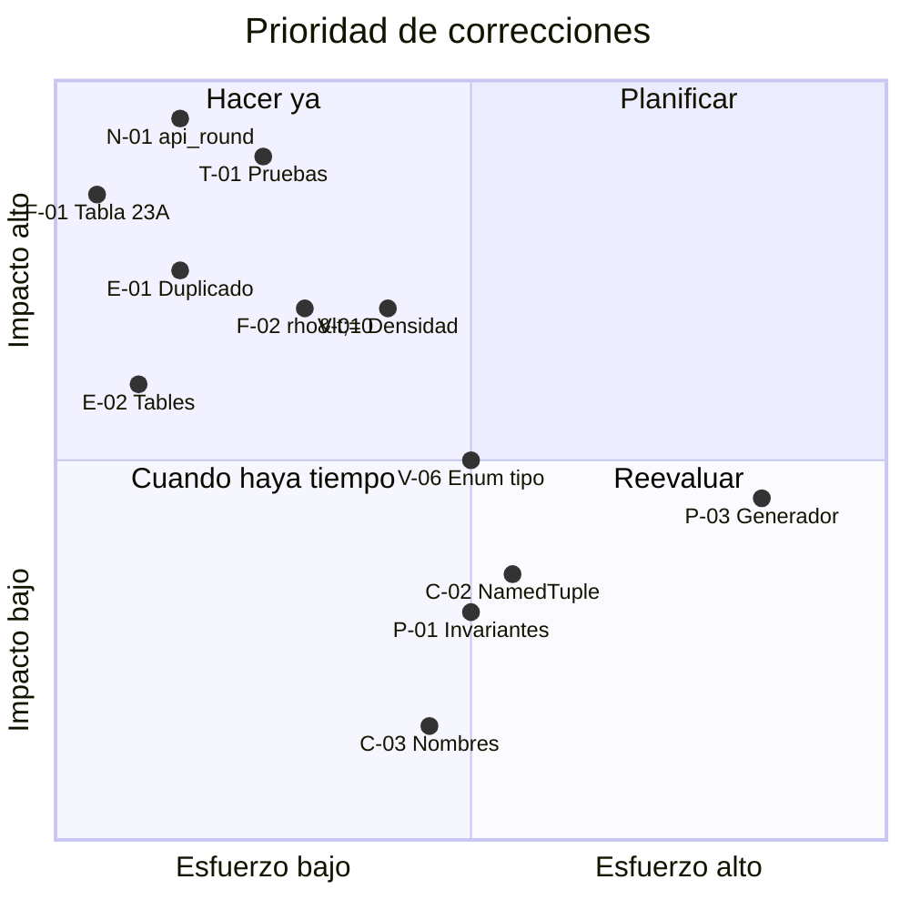

# 09 · Plan de acción

[⬅ Anterior: Anexo de evidencias](08_anexo_evidencias.md) · [Índice](README.md) · [Siguiente: Conformidad con la norma ➡](10_conformidad_norma.md)

> [!NOTE]
> **Estado al 2026-10-09:** la columna *Cierre* muestra el promedio de cierre de los hallazgos de cada acción. El orden real de ejecución y la verificación contra la norma están en [10 · Conformidad con la norma](10_conformidad_norma.md).

Orden sugerido de corrección. La premisa es **primero construir la red de seguridad (pruebas) y después corregir**, para que cada cambio quede verificado.

## 📑 Contenido

1. [Fase 0 — Red de seguridad](#fase-0)
2. [Fase 1 — Correcciones críticas](#fase-1)
3. [Fase 2 — Robustez y validación](#fase-2)
4. [Fase 3 — Estructura y empaquetado](#fase-3)
5. [Fase 4 — Rendimiento y calidad](#fase-4)
6. [Matriz esfuerzo / impacto](#matriz)

---

## Fase 0 — Red de seguridad

| # | Acción | Hallazgos | Esfuerzo | Cierre |
|:---:|---|---|:---:|:---:|
| 0.1 | Convertir los ejemplos de `test_6_1.py` / `test_6_2.py` en pruebas `pytest` con `assert` y moverlos a `tests/` en la raíz | [T-01](05_pruebas.md#t-01), [E-05](04_estructura_empaquetado.md#e-05) | 🟢 Bajo | ✅ 100 % |
| 0.2 | Añadir `pytest` como dependencia de desarrollo y `[tool.pytest.ini_options]` | [T-03](05_pruebas.md#t-03), [E-03](04_estructura_empaquetado.md#e-03) | 🟢 Bajo | ✅ 100 % |
| 0.3 | Añadir pruebas de casos borde **marcadas `xfail`** para cada bug de este informe (se quitan las marcas al corregir) | [T-02](05_pruebas.md#t-02) | 🟡 Medio | ✅ 100 % |

---

## Fase 1 — Correcciones críticas

| # | Acción | Hallazgos | Esfuerzo | Cierre |
|:---:|---|---|:---:|:---:|
| 1.1 | Reimplementar `api_round` con `decimal` ([propuesta](03_precision_numerica.md#propuesta-de-reimplementación-de-api_round)) | [N-01](03_precision_numerica.md#n-01), [N-02](03_precision_numerica.md#n-02) | 🟢 Bajo | ✅ 100 % |
| 1.2 | Corregir `gamma_t_to_rho(t_obs_raw)` → `gamma_t_to_rho(rel_obs)` | [F-01](01_errores_funcionales.md#f-01) | 🟢 Bajo | ✅ 100 % |
| 1.3 | Eliminar la implementación duplicada de tablas; dejar una sola fuente | [E-01](04_estructura_empaquetado.md#e-01) | 🟢 Bajo | ✅ 100 % |
| 1.4 | Renombrar `Tables` → `tables` en git | [E-02](04_estructura_empaquetado.md#e-02) | 🟢 Bajo | ✅ 100 % |

> [!WARNING]
> Tras 1.1, **todas** las salidas de las funciones de tabla pueden cambiar en el último dígito para entradas que son empates decimales. Si hay valores ya calculados y almacenados con la versión actual, conviene identificar cuáles se ven afectados.

---

## Fase 2 — Robustez y validación

| # | Acción | Hallazgos | Esfuerzo | Cierre |
|:---:|---|---|:---:|:---:|
| 2.1 | Crear `validate_density_kgm3` y llamarlo al inicio de 6.1/6.2; mover la guardia `rho_60 <= 0` al principio | [V-01](02_validacion_y_errores.md#v-01), [F-02](01_errores_funcionales.md#f-02), [F-08](01_errores_funcionales.md#f-08) | 🟡 Medio | ✅ 100 % |
| 2.2 | Rechazar `NaN`/`inf`/`None` en presión, temperatura y `alpha_60` | [V-03](02_validacion_y_errores.md#v-03), [V-04](02_validacion_y_errores.md#v-04) | 🟢 Bajo | ✅ 100 % |
| 2.3 | `Enum` `CommodityType` + validador único; unificar `commodity_group`/`commodity_type` | [V-06](02_validacion_y_errores.md#v-06), [F-06](01_errores_funcionales.md#f-06) | 🟡 Medio | ✅ 100 % |
| 2.4 | `alpha_60_c is not None` en 7.1/7.2 | [F-05](01_errores_funcionales.md#f-05) | 🟢 Bajo | ✅ 100 % |
| 2.5 | Exigir exactamente una temperatura en `its90_to_ipts68` | [F-07](01_errores_funcionales.md#f-07) | 🟢 Bajo | ✅ 100 % |
| 2.6 | Distinguir “fuera de rango” de “no converge” en 6.2; usar `_MAX_ITER` en el mensaje | [V-05](02_validacion_y_errores.md#v-05) | 🟡 Medio | ✅ 100 % |
| 2.7 | Proteger conversiones de `section_5_1` | [V-07](02_validacion_y_errores.md#v-07) | 🟢 Bajo | ✅ 100 % |

---

## Fase 3 — Estructura y empaquetado

| # | Acción | Hallazgos | Esfuerzo | Cierre |
|:---:|---|---|:---:|:---:|
| 3.1 | Corregir imports del generador, moverlo a `scripts/` y declarar `numpy`/`pandas` como extra opcional | [F-03](01_errores_funcionales.md#f-03), [E-03](04_estructura_empaquetado.md#e-03) | 🟢 Bajo | ✅ 100 % |
| 3.2 | Corregir anotaciones de retorno; introducir `NamedTuple` de resultados | [F-04](01_errores_funcionales.md#f-04), [C-02](07_calidad_mantenibilidad.md#c-02), [F-09](01_errores_funcionales.md#f-09) | 🟡 Medio | ✅ 100 % |
| 3.3 | Definir API pública en `__init__.py`, `__all__` y `py.typed` | [E-06](04_estructura_empaquetado.md#e-06) | 🟢 Bajo | ✅ 100 % |
| 3.4 | Actualizar README (import, estructura, alcance, licencia) | [E-04](04_estructura_empaquetado.md#e-04) | 🟢 Bajo | ✅ 100 % |
| 3.5 | Centralizar constantes y derivar `Da` y límites de `COMMODITY_GROUPS` | [N-04](03_precision_numerica.md#n-04) | 🟡 Medio | ✅ 100 % |

---

## Fase 4 — Rendimiento y calidad

| # | Acción | Hallazgos | Esfuerzo | Cierre |
|:---:|---|---|:---:|:---:|
| 4.1 | Separar núcleo de cálculo y validación; precalcular invariantes en 6.2 | [P-01](06_rendimiento.md#p-01), [P-02](06_rendimiento.md#p-02) | 🟡 Medio | ✅ 100 % |
| 4.2 | Refactorizar el generador: una función parametrizada, rangos enteros, `NaN`, excepciones concretas, paralelismo | [P-03](06_rendimiento.md#p-03), [P-04](06_rendimiento.md#p-04), [N-03](03_precision_numerica.md#n-03), [V-02](02_validacion_y_errores.md#v-02), [C-05](07_calidad_mantenibilidad.md#c-05), [C-06](07_calidad_mantenibilidad.md#c-06) | 🔴 Alto | 🟡 95 % |
| 4.3 | Configurar `ruff`, `mypy` y `pre-commit`; limpiar variables sin uso, nombres y docstrings | [C-01](07_calidad_mantenibilidad.md#c-01), [C-03](07_calidad_mantenibilidad.md#c-03), [C-04](07_calidad_mantenibilidad.md#c-04) | 🟡 Medio | 🟡 93 % |
| 4.4 | CI en Linux que ejecute pruebas, `ruff` y `mypy` | [T-03](05_pruebas.md#t-03) | 🟢 Bajo | ✅ 100 % |

---

## Matriz esfuerzo / impacto

| Cuadrante | Hallazgos |
|---|---|
| **Hacer ya** (alto impacto, bajo esfuerzo) | N-01, N-02, F-01, T-01, E-01, E-02, F-02, F-05, F-07, V-03 |
| **Planificar** (alto impacto, mayor esfuerzo) | V-01, V-05, V-06, F-04 / C-02 |
| **Cuando haya tiempo** | C-01, C-03, C-04, E-06, P-02 |
| **Reevaluar** | P-03 (depende de si las tablas se generarán masivamente) |

---

[⬅ Anterior: Anexo de evidencias](08_anexo_evidencias.md) · [Índice](README.md) · [Siguiente: Conformidad con la norma ➡](10_conformidad_norma.md)
